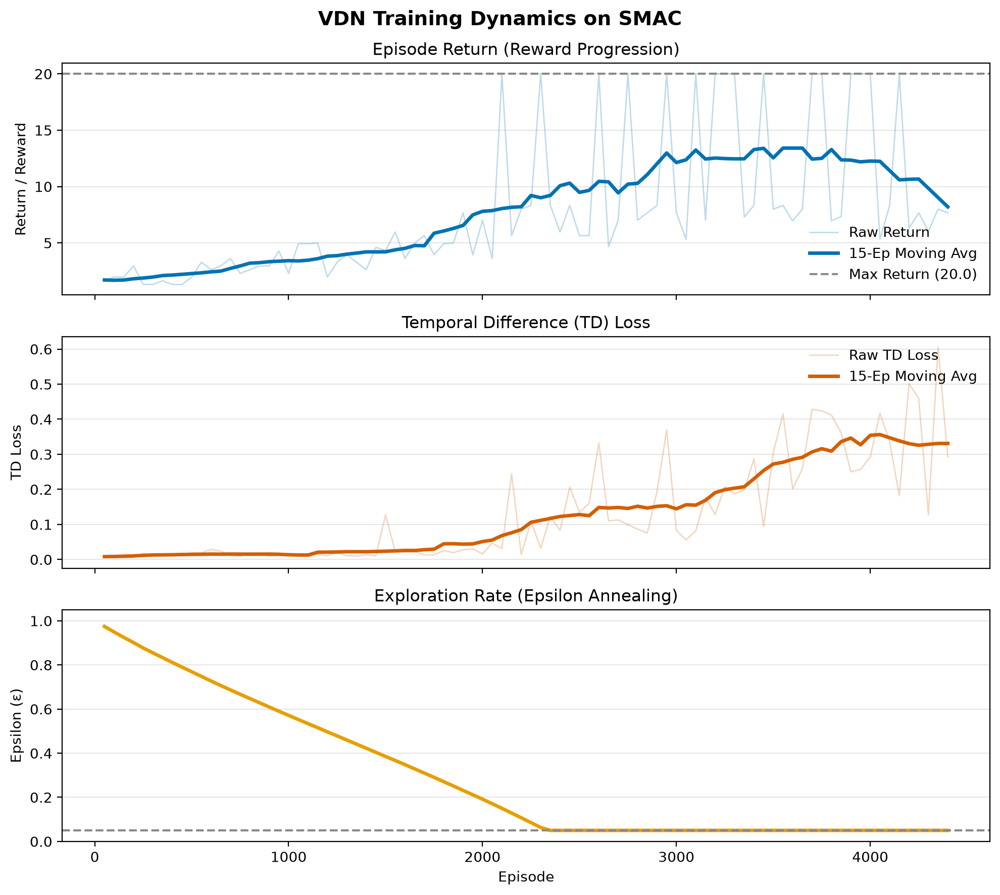

# Value Decomposition Networks (VDN) on StarCraft Multi-Agent Challenge (SMAC)

A modular, lightweight PyTorch implementation of **Value Decomposition Networks (VDN)** built from scratch for Multi-Agent Reinforcement Learning (MARL) on the **StarCraft Multi-Agent Challenge (SMAC)** environment.

---
## Table of Contents 
- [Overview](#overview)
- [Repository Structure](#repository-structure)
- [Prerequisites & System Setup](#prerequisites--system-setup)
-   - [1. Install StarCraft II Linux Binaries](#1-install-starcraft-ii-linux-binaries)
-   - [2. Download & Install SMAC Maps](#2-download--install-smac-maps)
-   - [3. Configure Environment Variables](#3-configure-environment-variables)
-   - [4. Set Executable Permissions](#4-set-executable-permissions)
- [Python Environment Setup](#python-environment-setup)
- [Verification](#verification)
- [Running Experiments](#running-experiments)
- [Outputs & Metrics](#outputs--metrics)

---

## Overview 
VDN solves cooperative multi-agent tasks under **Centralised Training with Decentralised Execution (CTDE)** by factorising the global joint action-value function <i>Q<sub>tot</sub>(τ, <b>u</b>)</i> into a linear sum of individual agent utility functions <i>Q<sub>i</sub>(τi, ui)</i>: 

<p align="center"> <b><i>Q<sub>tot</sub>(τ, <b>u</b>) = ∑ Q<sub>i</sub>(τi, ui)</i></b> </p>

This linear sum guarantees that taking individual greedy actions <b>argmax<sub>ui</sub> Q<sub>i</sub>(τi, ui)</b> maximizes <i>Q<sub>tot</sub></i>, enabling fully decentralized execution without inter-agent communication during test time.

--- 

## Repository Structure 
```text
.
├── README.md             # Project setup and experiment guide
├── requirements.txt      # Python dependencies
├── config.py             # Hyperparameter configuration
├── learner.py            # VDN loss computation and optimization pipeline
├── train.py              # Main training loop and episode rollout
├── models/
│   ├── __init__.py
│   ├── agent.py          # Recurrent DRQN Agent (GRUCell)
│   └── mixer.py          # VDN Linear Sum Mixer
└── utils/
    ├── __init__.py
    ├── replay_buffer.py  # Episode Replay Buffer with dynamic sequence padding
    └── plotter.py        # Real-time CSV metrics logging &amp; curve renderer
```

## Prerequisites &amp; System Setup

StarCraft II game binaries (\~4.6 GB) are **not included** in this repository and must be downloaded separately.

### 1. Install StarCraft II Linux Binaries

Download and extract Blizzard's official headless StarCraft II Linux client package (Version 4.10):
```
cd ~
# Download StarCraft II 4.10 Linux binary package
wget http://blzdistsc2-a.akamaihd.net/Linux/SC2.4.10.zip
# Extract to ~/StarCraftII (Password required by Blizzard EULA: iagreescadl)
unzip -P iagreescadl SC2.4.10.zip -d ~
```

### 2. Download & Install SMAC Maps

Download the SMAC map suite and unzip it directly into `~/StarCraftII/Maps/`:
```
# Download SMAC map archive
wget https://github.com/oxwhirl/smacv2/releases/download/maps/SMAC_Maps.zip

# Extract maps
unzip SMAC_Maps.zip -d ~/StarCraftII/Maps/

```
### 3. Configure Environment Variables

Inform PySC2/SMAC of the StarCraft II installation path by setting `SC2PATH`:
```
#Export SC2PATH for current terminal session
export SC2PATH=$HOME/StarCraftII

# Persist SC2PATH across all shell sessions
echo "export SC2PATH=\$HOME/StarCraftII" >> ~/.bashrc
source ~/.bashrc
```

### 4. Set Executable Permissions

Ensure that the game binaries in `Versions/` have execute permissions to avoid `ConnectError` or WebSocket connection failures:
```
chmod -R +x ~/StarCraftII/Versions/
```

## Python Environment Setup

### 1. Virtual Environment Creation

Create and activate a clean Python 3.10 / 3.11 virtual environment:
```
python3 -m venv venv
source venv/bin/activate
```
### 2. PyTorch Installation

**Note for Legacy NVIDIA GPUs (e.g. TITAN Xp / Pascal Compute Capability 6.1):** 
PyTorch 2.2+ default wheels drop CUDA support for Compute Capability 6.1 (`sm_61`). Install PyTorch compiled with CUDA 11.8 (`cu118`):

```
# Install PyTorch with CUDA 11.8 support
pip install torch==2.1.2 torchvision==0.16.2 --index-url https://download.pytorch.org/whl/cu118
```
For modern GPUs (Ampere / Ada Lovelace / Hopper), standard PyTorch 2.x can be installed directly.

###

### 3. Dependencies &amp; SMAC Installation

Install project dependencies using `requirements.txt`:
```
pip install "numpy<2.0.0"
pip install -r requirements.txt
```

## Verification

Before starting training, run this inline verification snippet to ensure StarCraft II initializes and connects cleanly:
```
python3 -c "import os; os.environ['SC2PATH'] = os.path.expanduser('~/StarCraftII'); from smac.env import StarCraft2Env; env = StarCraft2Env(map_name='3m'); env.reset(); print('SC2 Connected Successfully! Number of agents:', env.get_env_info()['n_agents']); env.close()"
```
## Running Experiments

### Start Training

To run VDN on the standard `3m` map:
```
python3 train.py
```

### Outputs & Metrics
During training, metrics are automatically logged to logs/training_metrics.csv and rendered into a figure saved at logs/vdn_training_metrics.png, tracking:
-  Episode Return / Reward: Raw and moving-average cumulative score.
-  TD Loss: Mean squared temporal-difference error.
-  Epsilon ε: Exploration decay curve.

