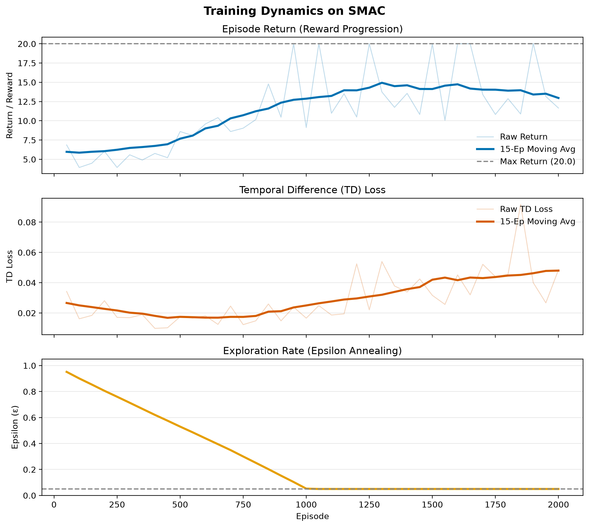
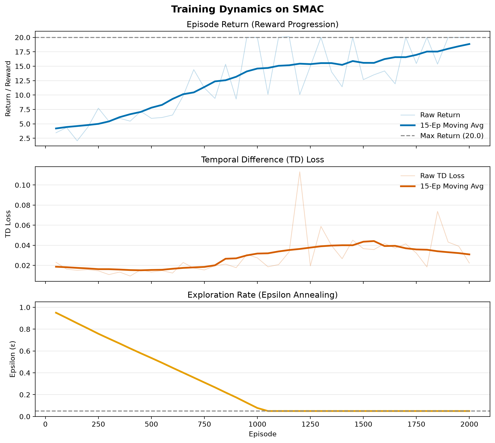

# Value Decomposition Networks (VDN) & QMIX on StarCraft Multi-Agent Challenge (SMAC)

A modular, lightweight PyTorch implementation of **Value Decomposition Networks (VDN)** and  **QMIX** built from scratch for Multi-Agent Reinforcement Learning (MARL) on the **StarCraft Multi-Agent Challenge (SMAC)** environment.

---
## Table of Contents 
- [Overview](#overview)
- [Repository Structure](#repository-structure)
- [Prerequisites & System Setup](#prerequisites--system-setup)
-   - [1. Install StarCraft II Linux Binaries](#1-install-starcraft-ii-linux-binaries)
-   - [2. Download & Install SMAC Maps](#2-download--install-smac-maps)
-   - [3. Configure Environment Variables](#3-configure-environment-variables)
-   - [4. Set Executable Permissions](#4-set-executable-permissions)
- [Python Environment Setup](#python-environment-setup)
- [Verification](#verification)
- [Running Experiments](#running-experiments)
- [Outputs & Metrics](#outputs--metrics)

---

## Overview 
In cooperative multi-agent reinforcement learning, agents must learn to coordinate actions to achieve a shared objective. Under Centralised Training with Decentralised Execution (CTDE), agents have access to full global state information during training, but must select actions independently based only on local observation histories &tau;<sup>i</sup> during execution.
This repository implements two foundational value-based MARL algorithms:

VDN (Value Decomposition Networks): Uses linear additivity to factorise the joint action-value function.
QMIX: Uses state-conditioned hypernetworks to enforce a monotonic factorisation, enabling richer representational capacity.

--- 

## Algorithmic Background

### Value Decomposition Networks (VDN)

VDN decomposes the joint action-value function <i>Q<sub>tot</sub></i>(<b>τ</b>, <b>u</b>) into a linear sum of individual agent utility functions <i>Q<sub>i</sub></i>(<i>τi</i>, <i>ui</i>):

<p align="center"><b><i>Q<sub>tot</sub>(<b>τ</b>, <b>u</b>) = ∑<sub>i=1</sub>n Q<sub>i</sub>(τi, ui)</i></b></p>

This linear sum guarantees that taking individual greedy actions argmaxui <i>Q<sub>i</sub></i>(<i>τi</i>, <i>ui</i>) traces directly to the optimal joint action argmaxu <i>Q<sub>tot</sub></i>(<b>τ</b>, <b>u</b>).

---

### QMIX

QMIX expands upon VDN by allowing non-linear representations while preserving monotonicity. The monotonicity constraint requires that a choice made by an individual agent that increases its utility <i>Q<sub>i</sub></i> also increases the overall joint action-value <i>Q<sub>tot</sub></i>:

<p align="center"><b>(∂<i>Q<sub>tot</sub></i> / ∂<i>Q<sub>i</sub></i>) ≥ 0,    ∀i ∈ {1, ..., n}</b></p>

To enforce <i>W > 0</i>, QMIX uses state-conditioned hypernetworks whose output weights are passed through an absolute value activation (torch.abs).

---

## Repository Structure 
```text
.
├── models/
│ ├── __init__.py
│ ├── agent.py             # Recurrent DRQN Agent (GRUCell)
│ ├── vdn_mixer.py         # VDN Linear Sum Mixer
│ └── qmix_mixer.py        # QMIX Monotonic Hypernetwork Mixer
├── vdn/
│ ├── learner.py           # VDN Learner (Linear sum factorization)
│ └── train.py             # VDN Training loop
├── qmix/
│ ├── learner.py           # QMIX Learner (State-conditioned monotonic mixing)
│ └── train.py             # QMIX Training loop
├── utils/
│ ├── __init__.py
│ ├── replay_buffer.py     # Replay Buffer with dynamic sequence padding
│ └── plotter.py           # Metrics logging & curve renderer
├── config.py              # Hyperparameter configuration
└── requirements.txt       # Python dependencies
```

## Prerequisites &amp; System Setup

StarCraft II game binaries (\~4.6 GB) are **not included** in this repository and must be downloaded separately.

### 1. Install StarCraft II Linux Binaries

Download and extract Blizzard's official headless StarCraft II Linux client package (Version 4.10):
```
cd ~
# Download StarCraft II 4.10 Linux binary package
wget http://blzdistsc2-a.akamaihd.net/Linux/SC2.4.10.zip
# Extract to ~/StarCraftII (Password required by Blizzard EULA: iagreescadl)
unzip -P iagreescadl SC2.4.10.zip -d ~
```

### 2. Download & Install SMAC Maps

Download the SMAC map suite and unzip it directly into `~/StarCraftII/Maps/`:
```
# Download SMAC map archive
wget https://github.com/oxwhirl/smacv2/releases/download/maps/SMAC_Maps.zip

# Extract maps
unzip SMAC_Maps.zip -d ~/StarCraftII/Maps/

```
### 3. Configure Environment Variables

Inform PySC2/SMAC of the StarCraft II installation path by setting `SC2PATH`:
```
#Export SC2PATH for current terminal session
export SC2PATH=$HOME/StarCraftII

# Persist SC2PATH across all shell sessions
echo "export SC2PATH=\$HOME/StarCraftII" >> ~/.bashrc
source ~/.bashrc
```

### 4. Set Executable Permissions

Ensure that the game binaries in `Versions/` have execute permissions to avoid `ConnectError` or WebSocket connection failures:
```
chmod -R +x ~/StarCraftII/Versions/
```

## Python Environment Setup

### 1. Virtual Environment Creation

Create and activate a clean Python 3.10 / 3.11 virtual environment:
```
python3 -m venv venv
source venv/bin/activate
```
### 2. PyTorch Installation

**Note for Legacy NVIDIA GPUs (e.g. TITAN Xp / Pascal Compute Capability 6.1):** 
PyTorch 2.2+ default wheels drop CUDA support for Compute Capability 6.1 (`sm_61`). Install PyTorch compiled with CUDA 11.8 (`cu118`):

```
# Install PyTorch with CUDA 11.8 support
pip install torch==2.1.2 torchvision==0.16.2 --index-url https://download.pytorch.org/whl/cu118
```
For modern GPUs (Ampere / Ada Lovelace / Hopper), standard PyTorch 2.x can be installed directly.

###

### 3. Dependencies &amp; SMAC Installation

Install project dependencies using `requirements.txt`:
```
pip install "numpy<2.0.0"
pip install -r requirements.txt
```

## Verification

Before starting training, run this inline verification snippet to ensure StarCraft II initializes and connects cleanly:
```
python3 -c "import os; os.environ['SC2PATH'] = os.path.expanduser('~/StarCraftII'); from smac.env import StarCraft2Env; env = StarCraft2Env(map_name='3m'); env.reset(); print('SC2 Connected Successfully! Number of agents:', env.get_env_info()['n_agents']); env.close()"
```
## Running Experiments

### Start Training

To run VDN on the standard `2s3z` map:
```
python3 vdn/train.py
```
To run QMIX on the standard `2s3z` map:
```
python3 qmix/train.py
```

### Outputs & Metrics
Evaluated on the **2s3z** map (2 Stalkers and 3 Zealots), **QMIX** achieves faster learning velocity and consistently higher battle win rates compared to **VDN**, as the monotonic hypernetwork effectively leverages global state information during centralised training.
-  Episode Return / Reward: Raw and moving-average cumulative score.
-  TD Loss: Mean squared temporal-difference error.
-  Epsilon ε: Exploration decay curve.

### VDN


### QMIX


